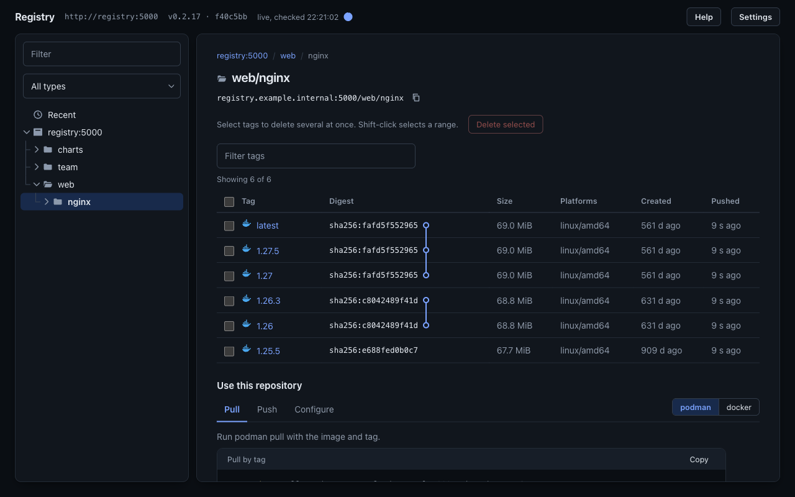
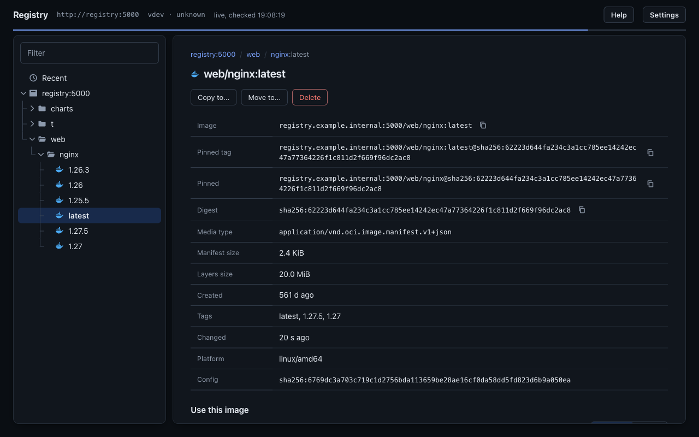
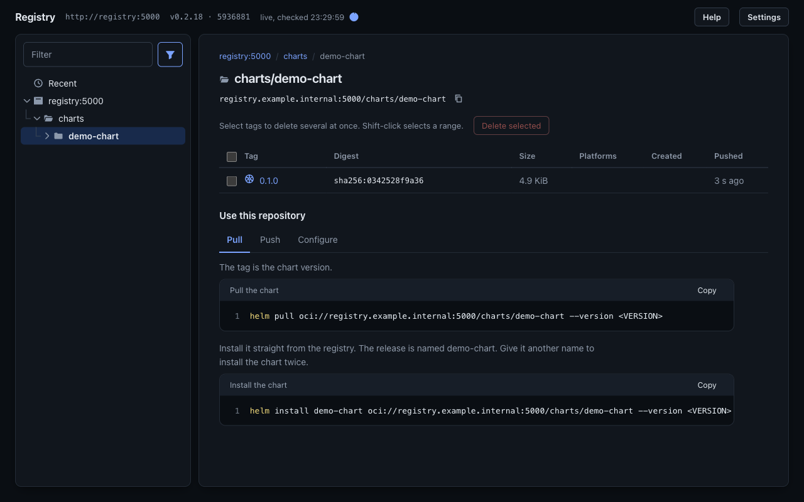
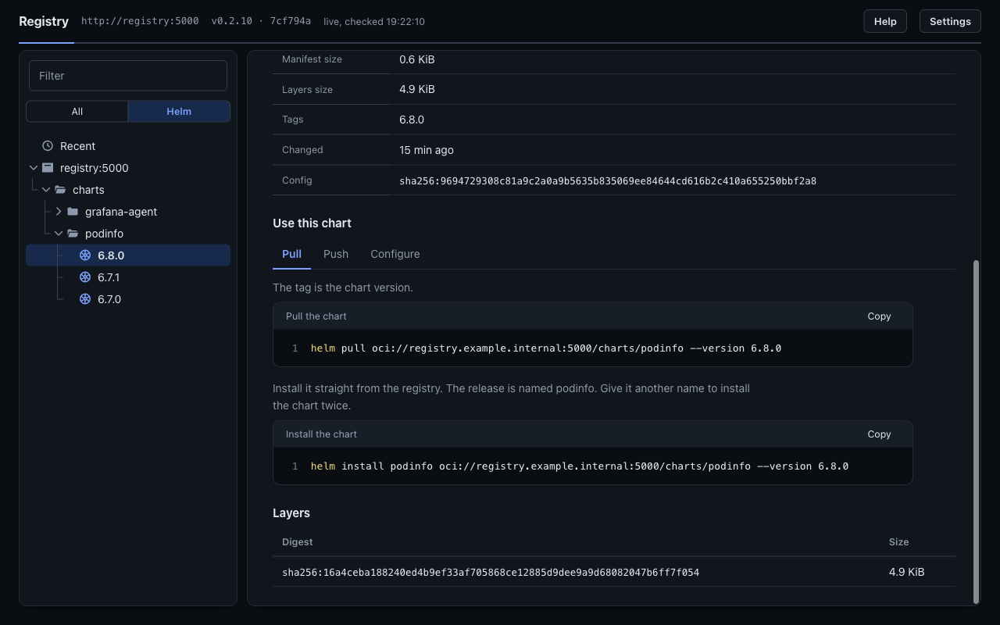
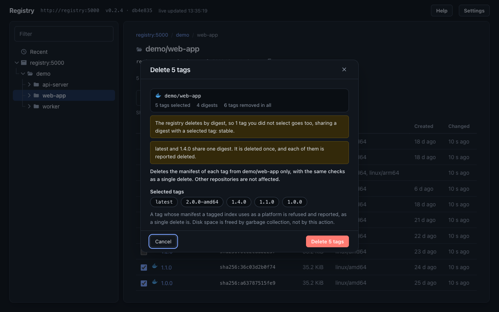

# registry-lite-ui

A web UI for a plain `registry:2` that browses, copies, moves and deletes images, and optionally browses a GitLab PyPI index.









## Requirements

- Docker Compose v2, or podman-compose 1.2+ (the auth overrides use `!reset`).
- `registry:2` (distribution 2.8) with `REGISTRY_STORAGE_DELETE_ENABLED=true` for move and delete. Browse and copy work without it. No token-auth registries.
- For PyPI: GitLab 16+ with the PyPI package registry.
- linux/amd64 or linux/arm64.

## Config

Set on the `registry-lite-ui` service. The full set is `Config` in `app/server.py` and `Source` in `app/pypi.py`.

| Req | Name | Default | Purpose |
|---|---|---|---|
| Required | `REGISTRY_URL` | `http://registry:5000` | The only registry the UI talks to. |
| Optional | `UI_REGISTRY_HOST` | host:port of `REGISTRY_URL` | The registry address clients type, used in the pull and push commands. |
| Optional | `UI_ALLOWED_HOSTS` | compose: `localhost,127.0.0.1,[::1]` | `Host` allowlist against DNS rebinding. Set it to the name users type. |
| Optional | `UI_BIND`, `UI_PORT`, `REGISTRY_PORT` | `127.0.0.1`, `8080`, `5000` | Host publish address and ports. The UI is loopback-only until `UI_BIND` is set. |
| Optional | `UI_READONLY` | `false` | Hides and refuses copy, move and delete. |
| Optional | `UI_ENVIRONMENTS` | `dev,test,uat,staging,prod` | Stage prefixes, in order, offered as promote shortcuts in Copy to and Move to. |
| Optional | `UI_REGISTRY_STORAGE` | empty | Host path or volume of the registry data, shown in the garbage collection commands in Help. |
| Optional | `UI_REGISTRY_SERVICE` | compose: `registry` | Compose service name of the registry, shown in the compose form of the garbage collection commands in Help. |
| Optional | `UI_POLL_INTERVAL`, `UI_MAX_EVENTS`, `UI_MAX_EVENT_DAYS` | `30`, `1000`, `30` | Seconds between registry walks, and the Recent history caps. |
| Optional | `UI_POLL_BURST`, `UI_POLL_BURST_MAX` | `5`, `600` | While a push has uploaded layers but not its manifest (the repository is listed, its tags answer 404), walk every `UI_POLL_BURST` seconds instead, for at most `UI_POLL_BURST_MAX` seconds from when it was first seen. `0` turns it off. A new tag in a repository that already has tags shows at the next normal walk. |
| Optional | `UI_POLL_MIN` | `10` | The shortest walk interval a viewer may pick in Settings, Refresh interval. The pick holds while that viewer's tab is open and visible, the shortest pick wins for every viewer, and a pick never makes the walk slower than `UI_POLL_INTERVAL`. Values under 10 count as 10. |
| When the registry has basic auth | `REGISTRY_USER`, `REGISTRY_PASSWORD_FILE` | empty | Registry credentials. See `compose.registry-auth.yml`. |
| When the registry is HTTPS | `REGISTRY_CA_FILE` | system store | CA bundle (or the self-signed certificate) for `REGISTRY_URL`. Verification never turns off. |
| When the UI serves HTTPS | `UI_TLS_CERT`, `UI_TLS_KEY` | empty | Certificate and key for the UI listener, TLS 1.2+. |
| When PyPI is on | `PYPI_INDEX_URL` | none | The index pip is given: `https://<gitlab>/api/v4/groups/<id or path>/-/packages/pypi/simple` or `.../projects/<id or path>/packages/pypi/simple`. |
| When PyPI is on | `secrets/gitlab_token` | none | A personal, group or project access token with `read_api`, never sent to the browser. A deploy token does not work: GitLab answers it 401 on the packages API. Leave the file empty for a public index. |
| To delete Python packages | `secrets/gitlab_delete_token` | none | A second token, with the `api` scope and the Maintainer role on the index's projects. Never the read token. Without it, delete is hidden and refused. See `compose.pypi-delete.yml`. |
| Optional | `UI_PYPI_PUBLIC_URL` | base of `PYPI_INDEX_URL` | The GitLab address pip users type, when it differs. |
| Optional | `UI_PYPI_PUBLIC` | `false` | Behind `compose.oidc.yml`, PyPI needs a login unless this is `true`. |

## Minimum configuration

`.env`:

```sh
UI_IMAGE=ghcr.io/newen-systems/registry-lite-ui:0.2.1
UI_REGISTRY_HOST=registry.example.internal:5000
```

## Usage

```sh
docker compose up -d   # registry on :5000 as before, UI on http://localhost:8080
```

## Image

| | |
|---|---|
| Reference | `ghcr.io/newen-systems/registry-lite-ui` |
| Base | `registry.access.redhat.com/ubi9/python-312-minimal`, pinned by digest in `Containerfile`, stdlib only |
| Platforms | linux/amd64, linux/arm64 |
| User | uid and gid 65534, read-only root filesystem, no capabilities |

## Tags

A release is `X.Y.Z`, `X.Y`, `X` and `latest`; main is `edge`; every build has its commit sha. Pin `UI_IMAGE` to `X.Y.Z` or a digest, and Renovate finds new releases. A release is a pushed tag that matches `VERSION`: `git tag -a v0.2.1 -m "registry-lite-ui 0.2.1" && git push origin v0.2.1`.

## Ports and volumes

- UI on 8080, the registry on 5000. The UI is never on the push or pull path: stop it and clients carry on.
- `ui-state` at `/state` holds `state.json`, the Recent history. The image writes there by default (`UI_STATE_DIR=/state`), so history survives a restart of the container. Mount a volume at `/state` to keep it when the container is removed or the root filesystem is read-only, which the compose files do. `UI_STATE_DIR=` (empty) keeps history in memory only.
- `registry-data` holds the images. `registry-init` gives it to uid 65534 once, as the registry runs as 65534 too.

## Overrides

Add each with `-f`, after `compose.yml` (or after `compose.ui.yml` for a registry that already runs elsewhere).

| File | Adds | Set |
|---|---|---|
| `compose.ui.yml` | The UI alone, used in place of `compose.yml`. | `REGISTRY_URL`, and `CERTS_DIR`, `KEYS_DIR` for HTTPS. |
| `compose.pypi.yml` | The PyPI source: a second tree root and a type filter. | `PYPI_INDEX_URL`, `secrets/gitlab_token`. |
| `compose.pypi-delete.yml` | Deleting Python package versions, after `compose.pypi.yml`. | `secrets/gitlab_delete_token`. |
| `compose.oidc.yml` | oauth2-proxy in front. Reads stay anonymous, a login gates changes and PyPI. | `OIDC_ISSUER_URL`, `OIDC_CLIENT_ID`, `OIDC_CLIENT_SECRET`, `OIDC_COOKIE_SECRET`, `OIDC_REDIRECT_URL`, `OIDC_EMAIL_DOMAINS`, `UI_ALLOWED_HOSTS`, optional `OIDC_ALLOWED_GROUPS`. |
| `compose.ldap.yml` | dex with LDAP as the issuer, after `compose.oidc.yml`. | `LDAP_BIND_PW`, `DEX_HOST`, `TLS_CERT`, `DEX_TLS_KEY`; edit `auth/dex-ldap.yaml`. |
| `compose.basic.yml` | nginx basic auth in front of everything. | `auth/htpasswd` (`htpasswd -B -c auth/htpasswd admin`), `UI_ALLOWED_HOSTS`. |
| `compose.tls.yml` | HTTPS for the registry and the UI from one certificate. | `REGISTRY_HOST`, `TLS_CERT`, `TLS_KEY`, `UI_TLS_KEY`. |
| `compose.oidc-tls.yml`, `compose.basic-tls.yml` | HTTPS on the proxy instead of the UI. | `TLS_CERT`, `PROXY_TLS_KEY`. |
| `compose.registry-auth.yml` | The UI's credentials for a registry with basic auth. | `REGISTRY_USER`, `secrets/registry_password`. |

## Preconditions

- Files the containers read (keys, certificates, `secrets/*`, a host `/data/registry`) belong to uid 65534: `chown -R 65534:65534 <dirs>`, or `podman unshare chown` for rootless podman. Mount shared directories with `:z` under SELinux.
- The overrides add to the service named `registry-lite-ui`. Renaming that service leaves the override as a second service without an image, and compose refuses to start (`has neither an image nor a build context`). To name the container, keep the service and set `container_name` in your own override file.
- The OIDC issuer sends `email` with `email_verified` true, and a `groups` claim when `OIDC_ALLOWED_GROUPS` is set.
- The PyPI token's user can read the group or project, or the index is public and the token file is empty.

## Keycloak

`compose.oidc.yml` works with Keycloak as the issuer. In the realm:

1. Create an OpenID Connect client with Client authentication on, Standard flow on and Direct access grants off. Set PKCE to S256 (Advanced, Proof Key for Code Exchange).
2. Set Valid redirect URIs to `https://<ui host>/oauth2/callback`, Web origins to `https://<ui host>` and Valid post logout redirect URIs to `https://<ui host>/*`.
3. In `.env`, set `OIDC_ISSUER_URL=https://<keycloak host>/realms/<realm>`, `OIDC_CLIENT_ID` to the client ID, `OIDC_CLIENT_SECRET` from the client's Credentials tab, and `OIDC_REDIRECT_URL` to the redirect URI above.
4. To admit only one group, set `OIDC_ALLOWED_GROUPS` to the group name, without a leading `/`. oauth2-proxy then asks for a `groups` scope, which Keycloak does not have by default, and the login fails with `invalid_scope`. Create a client scope named `groups` (Client scopes, Create, Include in token scope on). Give it a Group Membership mapper with Token claim name `groups` and Full group path off. Add the scope to the client as Default.

- Users imported from LDAP or FreeIPA arrive with `email_verified` false, and oauth2-proxy refuses them after a good Keycloak login. If the directory vouches for its addresses, add a hardcoded-attribute mapper to the user federation that sets `emailVerified` to `true`.
- Test with a directory account in the allowed group. A local account made in the admin console has a verified email and skips the federation, so it can log in while directory users cannot.
- Group membership is checked at login. Removing someone from the group takes effect when their session cookie expires, after 7 days by default (`OAUTH2_PROXY_COOKIE_EXPIRE` in your own override shortens it).

## Behaviour

- **Recent** is when the UI saw a change: the registry API has no push times, and pushes before the UI started are not in it. PyPI upload times come from GitLab.
- **Helm filter.** Once the poller has read a Helm chart, the funnel beside the sidebar's Filter offers Helm charts (only the repositories that hold charts, in the tree, the lists and Recent) and Containers (all the others). A repository with both charts and images counts as a chart repository.
- **Copy** mounts blobs and writes the original manifest bytes, so the digest does not change. **Move** is copy, check, then delete.
- **Delete** is by digest, so every tag on that digest goes, and the dialog lists them. A digest that a tagged index uses as a platform is refused (409).
- **Delete selected** deletes up to 100 tags of one repository at once: tick them in the tag list (the header box ticks every row shown), then confirm. Each digest goes through the single delete with its checks, an index before its own children. The dialog names the tags that go only because they share a digest with a ticked one, and the result lists each tag as deleted, skipped (already gone) or failed with the reason. Shift-click selects every row shown between the last one clicked and this one, and a click on a row outside its links ticks it too. Read-only mode and a missing login hide the checkboxes, and the API refuses the call as it does a single delete.
- **Sort.** Settings has one order for repositories and folders (Name by default), one for tags (Recent push by default, or Version) and one for Python packages (Name by default). A push is when the poller saw the tag take its digest, so it is accurate to one walk of the registry, and tags that were there before the UI first walked share its start time.
- **Delete Python packages** with `compose.pypi-delete.yml`: tick versions in a package's list, then confirm. Each version goes from every project that holds it, up to 100 uploads at once, through the GitLab packages API with the delete token. The result lists each upload as deleted, skipped (already gone) or failed with the reason.
- **Notify on push.** Settings, Live updates: a desktop notification for each push while the window is not in focus. Click it to open the tag. Needs HTTPS or localhost, and the page open in a tab.
- **Refresh pie.** The small circle beside "live, checked" runs down to the next walk of the registry: `UI_POLL_INTERVAL`, the burst during a push, or the back-off while the registry fails. While the live stream is down it runs down to the next fallback poll set in Settings. With reduced motion it moves in one-second steps.
- **Garbage collection** is not run by the UI. Help shows the commands, for a registry container of its own (stopped) or a compose service (running, with no pushes). Never add `--delete-untagged`: it breaks multi-arch images in registry 2.8.
- **Empty repositories** stay in the catalog, because the registry API cannot delete them. The UI hides them unless Settings shows them.
- **PyPI** versions sort by PEP 440. A version held by several projects lists each copy with its files, SHA-256, Requires-Python and wheel platforms. Commands come for pip or uv on Linux/macOS or Windows, and leave out the token while GitLab serves the index anonymously.
- **Auth.** CSRF token, JSON-only POST and an `Origin` check on every change. Behind `compose.oidc.yml`, the UI answers `/api/pypi/*` with 401 without a user, and the proxy strips a forged `X-Forwarded-Email`.
- **Self-healing.** Pollers back off while the registry or GitLab is down. `/healthz` turns 503 when a poller stalls, and a watchdog exits so `restart: unless-stopped` brings the UI back. Logs go to stdout, one line per request.

## Out of scope

- Uploading Python packages, and changing anything in GitLab other than deleting package versions.
- Running garbage collection, and token-auth registries.
- Per-user permissions and an audit log beyond the access log.

## Expected result

The UI on `http://localhost:8080` lists the registry's repositories:

```sh
curl -fs localhost:8080/healthz && curl -s localhost:8080/api/repos
```
